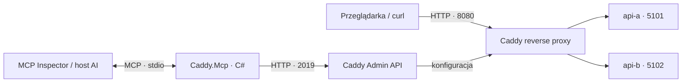

# Laboratorium 05 — Caddy sterowany przez MCP

**C# / .NET 10 · 90 minut · lokalne procesy, bez kontenerów**

## Cel

Zbudujesz narzędzia MCP, które odczytują konfigurację Caddy i przełączają ruch między dwoma backendami. Gotowy szkielet zawiera serwer MCP, klienta HTTP do API Caddy oraz dwie aplikacje ASP.NET Core. Do uzupełnienia są trzy metody w `src/Caddy.Mcp/CaddyTools.cs`.



MCP nie wymaga modelu językowego. Inspector jest klientem testowym: odkrywa narzędzia i pozwala je wywoływać. W aplikacji AI te same narzędzia mogą być wybierane przez model, a host odpowiada za ich wywołanie.

## Czym jest Caddy?

Caddy to serwer WWW, który może serwować pliki, zarządzać HTTPS i działać jako **reverse proxy**: przyjmuje żądanie i przekazuje je do backendu. W tym labie klient zawsze korzysta z portu 8080, a my zmieniamy aplikację, do której trafia ruch.

Caddy obsługuje czytelny Caddyfile i natywną konfigurację JSON. Używamy JSON, ponieważ API administracyjne operuje na tym samym modelu konfiguracji. Nie potrzebujemy domeny ani certyfikatów: wszystkie usługi działają lokalnie przez HTTP.

| Adres | Rola |
|---|---|
| `http://127.0.0.1:8080` | Ruch użytkowników przez Caddy |
| `http://127.0.0.1:2019` | API administracyjne Caddy |
| `http://127.0.0.1:5101` | Backend `api-a` |
| `http://127.0.0.1:5102` | Backend `api-b` |

W `caddy/caddy.json` handler `reverse_proxy` ma identyfikator `@id: lab-proxy`. Dzięki temu API pozwala odwoływać się do niego przez `/id/lab-proxy`, bez znajomości pozycji w tablicy tras.

| Operacja HTTP | Znaczenie |
|---|---|
| `GET /config/` | Bieżąca konfiguracja |
| `GET /id/lab-proxy/upstreams` | Lista backendów naszego proxy |
| `PATCH /id/lab-proxy/upstreams` | Zastąpienie listy backendów |
| `POST /load` | Wczytanie całej konfiguracji, np. reset labu |

Zmiany przez API dotyczą działającego procesu i nie edytują pliku `caddy.json`. W labie plik jest konfiguracją początkową; ponowne wczytanie przywraca `api-a`. Pojedyncze żądanie zmiany jest atomowe, ale sekwencja odczyt–modyfikacja–zapis nie jest jedną transakcją. Dlatego zmieniamy tylko listę upstreamów, zamiast nadpisywać całą konfigurację.

## Przygotowanie przed zajęciami

Zainstaluj:

- [.NET SDK 10](https://dotnet.microsoft.com/download/dotnet/10.0),
- [Caddy 2 — instalacja](https://caddyserver.com/docs/install),
- [Node.js LTS](https://nodejs.org/) z npm, potrzebny do MCP Inspector,
- edytor C# oraz curl (na Windows używaj `curl.exe`).

Caddy: macOS `brew install caddy`, Windows `winget install --id CaddyServer.Caddy --exact`; na Linux skorzystaj z instrukcji dla swojej dystrybucji. Jeżeli Homebrew uruchomiło Caddy jako usługę, zatrzymaj tę usługę przed labem (`brew services stop caddy`).

Sprawdź:

```sh
dotnet --version
caddy version
node --version
npm --version
```

Otwórz terminal w **katalogu tego laboratorium** (`docs/labs/05-mcp`). Wszystkie kolejne polecenia zakładają ten katalog roboczy. Na Windows polecenia curl w przykładach zastąp przez `curl.exe`.

```sh
dotnet restore CaddyLab.slnx
dotnet build CaddyLab.slnx --no-restore
npx --yes @modelcontextprotocol/inspector --help
```

Pierwsze pobranie pakietów wymaga internetu. Przygotowanie środowiska wykonaj przed zajęciami. Nie potrzebujesz Ollama, klucza API ani instalacji narzędzi kontenerowych.

## Uruchomienie (0–15 min)

Uruchom trzy osobne terminale; pozostaw procesy włączone.

**Terminal 1 — api-a:**

```sh
dotnet run --no-launch-profile --project src/ApiA
```

**Terminal 2 — api-b:**

```sh
dotnet run --no-launch-profile --project src/ApiB
```

**Terminal 3 — Caddy:**

```sh
caddy run --config caddy/caddy.json
```

W czwartym terminalu sprawdź:

```sh
curl http://127.0.0.1:5101/
curl http://127.0.0.1:5102/
curl http://127.0.0.1:8080/
curl http://127.0.0.1:8080/api/products
curl http://127.0.0.1:2019/id/lab-proxy/upstreams
```

Bezpośrednio backendy zwracają odpowiednio `service: api-a` i `service: api-b`. Przez Caddy początkowo odpowiada `api-a`. Każdy backend obsługuje `/`, `/health` i `/api/products`; proxy zachowuje ścieżkę żądania.

## Zadania (15–80 min)

Szczegółowe wymagania i kryteria odbioru: **[zadania Caddy MCP](caddy-experiments.md)**.

| Czas | Zadanie | Efekt |
|---|---|---|
| 15–25 min | Poznaj API i uruchom Inspector | Wywołanie gotowego `get_lab_info` |
| 25–40 min | TODO 1: `get_configuration` | Konfiguracja Caddy jako wynik narzędzia |
| 40–50 min | TODO 2: `get_active_backend` | Lista upstreamów |
| 50–70 min | TODO 3: `switch_backend` | Walidacja nazwy i przełączenie proxy |
| 70–80 min | Błędy i powrót do api-a | Czytelne błędy i działające cofnięcie |
| 80–90 min | Demonstracja i omówienie | Odbiór rozwiązania |

### MCP Inspector

Zbuduj serwer, a następnie uruchom Inspector, który sam uruchomi proces MCP:

```sh
dotnet build src/Caddy.Mcp
npx --yes @modelcontextprotocol/inspector dotnet src/Caddy.Mcp/bin/Debug/net10.0/Caddy.Mcp.dll
```

Otwórz adres wypisany przez Inspector (z tokenem, jeśli jest podany). Połącz transportem **STDIO**, odśwież listę Tools i wywołaj `get_lab_info`. Zobaczysz cztery narzędzia; trzy na początku zwracają komunikat `TODO`. To oczekiwane zachowanie szkieletu.

Po edycji kodu rozłącz serwer w Inspectorze, ponownie zbuduj projekt i połącz go ponownie. Jeśli plik jest blokowany na Windows, zatrzymaj Inspector przed budowaniem. Nie uruchamiaj osobno serwera MCP w terminalu: czeka on na komunikaty protokołu, a Inspector zarządza jego stdin/stdout. Logi trafiają na stderr; nie dodawaj `Console.WriteLine` do serwera.

### Podłączenie do hosta AI (opcjonalnie po zadaniach)

W hoście obsługującym lokalne serwery MCP stdio ustaw poniższe pola. Zastąp ścieżkę absolutną ścieżką na swoim komputerze; szczegóły formatu konfiguracji zależą od hosta.

```json
{
  "mcpServers": {
    "caddy-lab": {
      "command": "dotnet",
      "args": ["/ABSOLUTNA/SCIEZKA/docs/labs/05-mcp/src/Caddy.Mcp/bin/Debug/net10.0/Caddy.Mcp.dll"]
    }
  }
}
```

Przykładowe polecenie: „Sprawdź aktywny backend, przełącz na api-b i ponownie odczytaj konfigurację”. Efekt sprawdź niezależnie przez curl.

## Reset i zakończenie

Przy działającym Caddy, z katalogu laboratorium:

```sh
curl -X POST http://127.0.0.1:2019/load -H "Content-Type: application/json" --data-binary @caddy/caddy.json
```

Reset przywraca `api-a`. Zatrzymaj Inspector, backendy i Caddy przez Ctrl+C w ich terminalach. Uruchamiaj Caddy ponownie z `--config caddy/caddy.json`, bez `--resume`.

## Rozwiązywanie problemów

| Objaw | Co sprawdzić |
|---|---|
| Port zajęty | Zamknij poprzedni proces labu; porty 2019, 8080, 5101 i 5102 muszą być wolne |
| `502 Bad Gateway` | Caddy działa, ale wybrany backend jest wyłączony lub niedostępny |
| Brak połączenia z Caddy | Czy działa proces i API na 127.0.0.1:2019? |
| `404` przy `/id/lab-proxy/...` | Wczytano inną konfigurację Caddy; wykonaj reset |
| Wciąż komunikat TODO | Zbuduj projekt i ponownie połącz proces MCP |
| Inspector nie łączy się | Sprawdź ścieżkę DLL, katalog roboczy i logi stderr; stdout musi zawierać wyłącznie MCP |

API administracyjne kontroluje cały serwer: w konfiguracji labu nasłuchuje wyłącznie na loopback. Narzędzie zmiany ma przyjmować tylko nazwy dwóch przygotowanych backendów.

## Dokumentacja

- [Caddy: wprowadzenie](https://caddyserver.com/docs/getting-started)
- [Caddy: Admin API — ścieżki, metody i atomowość](https://caddyserver.com/docs/api)
- [Caddy: reverse_proxy](https://caddyserver.com/docs/caddyfile/directives/reverse_proxy)
- [Oficjalny C# SDK MCP](https://github.com/modelcontextprotocol/csharp-sdk)
- [MCP Inspector](https://github.com/modelcontextprotocol/inspector)
- [Wykład o MCP](../../lectures/04-mcp/README.md)

Wcześniejszy wariant ze sprzętem Shelly: [instrukcja](shelly.md) i [eksperymenty](experiments.md).
