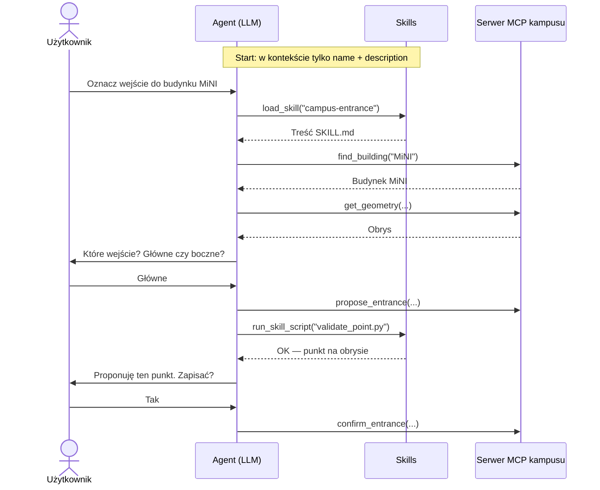
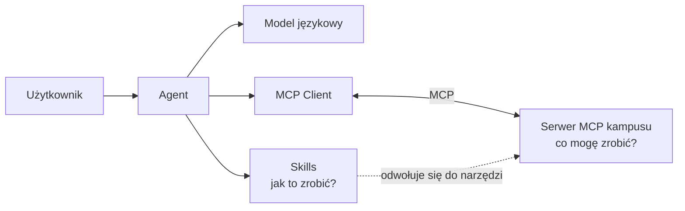

# Tworzenie agentów AI w .NET

## Wykład 05 — Skills

### Skąd agent wie, jak wykonać zadanie?

---

**Marcin Sulecki**  
marcin.sulecki@pw.edu.pl

## Cel wykładu

Na poprzednich wykładach poznaliśmy **Tool Calling** i **Model Context Protocol (MCP)**.

Wiemy już, jak udostępnić agentowi narzędzia, dane i szablony promptów.

Dostęp do narzędzi nie mówi jednak agentowi, **w jakiej kolejności** ich użyć, **jakich zasad** przestrzegać i **kiedy** zadanie można uznać za wykonane.

**Skills** pozwalają przekazać agentowi wiedzę o sposobie wykonywania zadań.

Podczas wykładu poznamy:

1. **Problem** — dlaczego same narzędzia nie wystarczają?
2. **Skill** — czym jest i czym różni się od narzędzia?
3. **Anatomię Skilla** — plik `SKILL.md`, skrypty, referencje i zasoby.
4. **Progressive disclosure** — jak agent korzysta z wielu Skills bez przepełniania kontekstu?
5. **Skills a MCP** — jak się uzupełniają?
6. **Skills w .NET** — jak udostępnić Skills agentowi w Microsoft Agent Framework?
7. **Projektowanie Skills** — jak napisać dobry Skill?
8. **Bezpieczeństwo** — dlaczego Skill jest kodem, a nie tylko dokumentacją?

## 1. Narzędzia to nie wszystko

### Czy agent z kompletem narzędzi wie, co robić?

Wyobraźmy sobie prośbę skierowaną do Tup Żaka:

> **Użytkownik:** Pomóż mi znaleźć i oznaczyć wejście do budynku MiNI.

Serwer MCP kampusu udostępnia narzędzia:

| Narzędzie | Przeznaczenie |
|---|---|
| `find_building` | Wyszukanie budynku po nazwie |
| `get_geometry` | Pobranie obrysu budynku |
| `propose_entrance` | Zaproponowanie punktu wejścia |
| `confirm_entrance` | Zapisanie zatwierdzonego wejścia |

Model widzi nazwy, opisy i schematy argumentów. Nie wie jednak:

- że przed zapisem trzeba **zapytać użytkownika**, którym wejściem wchodzi,
- że punkt wejścia musi leżeć **na obrysie** budynku, a nie w jego środku,
- że budynek może mieć **kilka wejść** (główne, boczne, dla osób z niepełnosprawnościami),
- że `confirm_entrance` zmienia dane i **wymaga potwierdzenia**,
- jak postąpić, gdy `find_building` zwróci kilka wyników.

Model może coś wymyślić. Czasem trafi, czasem nie.

**Pytanie przewodnie:**

> Gdzie zapisać wiedzę o tym, **jak** wykonać zadanie, skoro narzędzia mówią tylko, **co** można zrobić?

## 2. Gdzie można umieścić tę wiedzę?

| Miejsce | Zalety | Wady |
|---|---|---|
| **System prompt** | Proste, zawsze dostępne | Rośnie z każdą procedurą, zajmuje kontekst w każdym zapytaniu |
| **Opisy narzędzi** | Blisko miejsca użycia | Opis dotyczy jednego narzędzia, a procedura obejmuje kilka |
| **Kod aplikacji (workflow)** | Deterministyczne, testowalne | Sztywne — każda zmiana procedury wymaga zmiany kodu |
| **MCP Prompt** | Wielokrotnego użytku, udostępniany przez serwer | Wybierany przez użytkownika lub aplikację, nie przez model |
| **Skill** | Ładowany na żądanie, wybierany przez agenta | Wymaga dobrego opisu i dyscypliny przy tworzeniu |

Żadne z tych rozwiązań nie jest „złe”. Skill wypełnia lukę pomiędzy sztywnym workflow w kodzie a jednym wielkim system promptem.

**Kluczowa myśl:**

> Tool mówi agentowi, **co może zrobić**. Skill mówi agentowi, **jak ma to zrobić**.

## 3. Czym jest Skill?

**Skill** (Agent Skill) to spakowana, wielokrotnego użytku wiedza proceduralna: instrukcje, zasady, przykłady i opcjonalnie skrypty, które agent ładuje wtedy, gdy są potrzebne do wykonania zadania.

Skill można porównać do **instrukcji stanowiskowej** dla nowego pracownika:

- pracownik ma dostęp do systemów (narzędzia),
- ma dostęp do dokumentów (zasoby),
- ale dopiero instrukcja mówi mu, jak przeprowadzić konkretny proces.

Format Skills został zaproponowany przez Anthropic i opublikowany jako otwarty standard ([agentskills.io](https://agentskills.io)). Obsługują go m.in. Claude, Codex, Gemini CLI, Cursor oraz **Microsoft Agent Framework**.

### Co może zawierać Skill?

- **procedurę** — kolejne kroki zadania,
- **workflow** — rozgałęzienia i warunki („jeśli… to…”),
- **wiedzę domenową** — zasady, konwencje, słownik pojęć,
- **kryteria weryfikacji** — kiedy wynik jest poprawny,
- **przykłady** — dobre i złe rozwiązania,
- **skrypty** — deterministyczne operacje, których nie warto powierzać modelowi,
- **zasoby** — szablony, schematy, dane referencyjne.

## 4. Anatomia Skilla

Skill to **katalog**, którego sercem jest plik `SKILL.md`.

```text
campus-entrance/
├── SKILL.md              # instrukcje + metadane (wymagany)
├── references/
│   └── entrance-rules.md # szczegółowe zasady, ładowane w razie potrzeby
├── scripts/
│   └── validate_point.py # walidacja punktu względem obrysu
└── assets/
    └── entrance.schema.json
```

### Plik SKILL.md

Plik zaczyna się od nagłówka YAML (frontmatter). Wymagane są tylko pola `name` i `description`.

```markdown
---
name: campus-entrance
description: >
  Oznaczanie wejść do budynków kampusu PW. Użyj, gdy użytkownik chce
  znaleźć, dodać lub poprawić wejście do budynku na mapie.
---

# Oznaczanie wejścia do budynku

## Kroki

1. Znajdź budynek narzędziem `find_building`.
   Jeśli wyników jest kilka — zapytaj użytkownika, o który chodzi.
2. Pobierz obrys budynku narzędziem `get_geometry`.
3. Ustal z użytkownikiem, o które wejście chodzi
   (główne, boczne, dostępne dla osób z niepełnosprawnościami).
4. Zaproponuj punkt narzędziem `propose_entrance`.
   Punkt musi leżeć na obrysie budynku — sprawdź go skryptem
   `scripts/validate_point.py`.
5. Pokaż propozycję i **poczekaj na potwierdzenie** użytkownika.
6. Dopiero po potwierdzeniu wywołaj `confirm_entrance`.

## Zasady

- Nigdy nie zapisuj wejścia bez potwierdzenia użytkownika.
- Szczegółowe zasady nazewnictwa wejść: `references/entrance-rules.md`.
```

### Rola pola `description`

`description` jest najważniejszą linijką Skilla.

Na jej podstawie model decyduje, **czy w ogóle** sięgnąć po Skill. Opis powinien mówić:

- **co** Skill robi,
- **kiedy** należy go użyć.

**Pytanie:**

> Co się stanie, jeśli opis Skilla będzie brzmiał: „Skill do budynków”?

## 5. Progressive disclosure

### Jak korzystać z dziesiątek Skills i nie przepełnić kontekstu?

Gdyby wszystkie instrukcje trafiały do system promptu, kontekst szybko by się zapełnił — a model gorzej radzi sobie z długim, rozproszonym kontekstem.

Skills ładowane są **stopniowo**:

| Poziom | Co trafia do kontekstu | Kiedy | Orientacyjny koszt |
|---|---|---|---|
| **1. Metadane** | `name` + `description` | Zawsze, przy starcie agenta | ~100 tokenów na Skill |
| **2. Instrukcje** | Treść `SKILL.md` | Gdy agent uzna, że Skill pasuje do zadania | do ~5000 tokenów |
| **3. Zasoby** | Pliki z `references/`, `assets/`, wyniki `scripts/` | Tylko gdy instrukcja tego wymaga | dowolny |



**Kluczowa myśl:**

> Agent zna **katalog** Skills od początku, ale **treść** czyta dopiero wtedy, gdy jej potrzebuje.

To ten sam pomysł, który znamy z dokumentacji: najpierw spis treści, potem rozdział, na końcu załącznik.

## 6. Skills a MCP

Skills i MCP nie konkurują ze sobą. Odpowiadają na różne pytania.

| | Tools | Resources | Prompts | **Skills** |
|---|---|---|---|---|
| **Pytanie** | Co mogę zrobić? | Jakie mam dane? | Jak to opisać? | **Jak to zrobić?** |
| **Zawartość** | Operacja | Dane, kontekst | Szablon wiadomości | Procedura, zasady, skrypty |
| **Kto wybiera?** | Model | Zwykle aplikacja | Zwykle użytkownik | **Model** |
| **Kiedy w kontekście?** | Definicje zawsze | Gdy aplikacja dołączy | Gdy użytkownik wybierze | Metadane zawsze, treść na żądanie |
| **Gdzie żyje?** | Serwer MCP | Serwer MCP | Serwer MCP | Katalog / pakiet przy agencie |

### Skill a MCP Prompt

To najczęstsze pytanie. Oba zawierają instrukcje dla modelu.

| MCP Prompt | Skill |
|---|---|
| Szablon pojedynczej interakcji | Procedura wieloetapowego zadania |
| Wybierany jawnie (np. komenda `/energy-report`) | Wybierany przez model na podstawie opisu |
| Zwraca wiadomości | Zawiera instrukcje, referencje i skrypty |
| Udostępniany przez serwer | Dystrybuowany jako katalog plików |

### Jak to złożyć w całość?



**Wniosek:**

> MCP daje agentowi **ręce**. Skill daje agentowi **przepis**.

## 7. Skills w .NET

Microsoft Agent Framework obsługuje Agent Skills (od lipca 2026 r. API .NET jest stabilne).

### Trzy sposoby definiowania Skills

| Sposób | Kiedy |
|---|---|
| **Plikowy** — katalog z `SKILL.md` | Skill współdzielony z innymi agentami i narzędziami (Claude, Codex…) |
| **Klasowy** — klasa C# | Skill dystrybuowany razem z biblioteką |
| **W kodzie** — definiowany dynamicznie | Skill zależny od stanu aplikacji |

### Jak to działa?

1. `AgentSkillsProvider` przeszukuje wskazane katalogi w poszukiwaniu plików `SKILL.md`.
2. Waliduje ich format.
3. Do system promptu dodaje **tylko nazwy i opisy** Skills.
4. Udostępnia agentowi narzędzia:
   - `load_skill` — wczytanie instrukcji Skilla,
   - `read_skill_resource` — odczyt dołączonego zasobu,
   - `run_skill_script` — uruchomienie dołączonego skryptu.

Zwróćmy uwagę: **Skills działają dzięki Tool Calling**. Ładowanie Skilla to po prostu wywołanie narzędzia — mechanizm, który znamy z wykładu 03.

### Szkic konfiguracji

```csharp
// Szkic — dokładne nazwy typów sprawdź w aktualnej dokumentacji
// Microsoft Agent Framework.
var skills = new AgentSkillsProvider(skillsPaths: ["./skills"]);

AIAgent agent = chatClient.CreateAIAgent(new ChatClientAgentOptions
{
    Name = "TupZak",
    Instructions = "Jesteś asystentem kampusu PW.",
    AIContextProviders = [skills],
    ChatOptions = new() { Tools = [.. mcpTools] }
});
```

Szczegóły implementacji omówimy podczas laboratorium.

## 8. Jak napisać dobry Skill?

### Zasady

1. **Opis to wyzwalacz.** Napisz w `description`, co Skill robi i **kiedy** go użyć.
2. **Jeden Skill — jedno zadanie.** „Wszystko o kampusie” to nie Skill, to encyklopedia.
3. **Krótki `SKILL.md`.** Zalecane: poniżej ~500 linii. Szczegóły przenieś do `references/`.
4. **Pisz dla inteligentnego czytelnika.** Nie tłumacz modelowi, czym jest budynek. Pisz to, czego **nie wie**: zasady, wyjątki, konwencje twojej organizacji.
5. **Kroki i warunki zatrzymania.** Kiedy zapytać użytkownika? Kiedy przerwać?
6. **Deterministyczne rzeczy do skryptów.** Walidacja geometrii, parsowanie, obliczenia — to zadanie dla kodu, nie dla modelu.
7. **Kryteria sukcesu.** Jak agent ma sprawdzić, że skończył?

### Kiedy Skill, a kiedy workflow w kodzie?

| Workflow w kodzie | Skill |
|---|---|
| Kroki znane i stałe | Kroki zależą od sytuacji |
| Wymagana pełna powtarzalność | Wymagana elastyczność i dialog |
| Błąd jest kosztowny | Błąd można wykryć i poprawić |
| Np. księgowanie płatności | Np. oznaczanie wejścia z użytkownikiem |

Często najlepsze jest połączenie: **Skill prowadzi rozmowę, kod pilnuje reguł**.

**Pytanie:**

> Czy procedurę „Zapisz studenta na egzamin” zapisałbyś jako Skill, czy jako workflow w kodzie? Dlaczego?

## 9. Bezpieczeństwo

Skill wygląda jak dokumentacja, ale **działa jak kod**:

- instrukcje Skilla zmieniają zachowanie agenta,
- skrypty Skilla są uruchamiane w środowisku agenta.

### Zagrożenia

- **złośliwe instrukcje** ukryte w `SKILL.md` lub plikach referencyjnych (prompt injection),
- **złośliwe skrypty** — wyciek danych, modyfikacja plików,
- **zbyt szeroki opis** — Skill uruchamia się w niepożądanych sytuacjach,
- **Skills z niezaufanych źródeł** — „marketplace” to łańcuch dostaw jak każdy inny.

### Dobre praktyki

- traktuj instalację Skilla jak instalację zależności — **przeczytaj go przed użyciem**,
- uruchamiaj skrypty w **sandboxie** (więcej na wykładzie o Code Execution),
- **loguj**, które Skills, zasoby i skrypty zostały użyte,
- operacje ze skutkami ubocznymi nadal wymagają **potwierdzenia i autoryzacji po stronie aplikacji** — Skill może prosić o potwierdzenie, ale nie może go gwarantować.

**Kluczowa zasada:**

> Skill **sugeruje** sposób działania. Gwarancje bezpieczeństwa muszą zapewniać aplikacja i narzędzia.

## Podsumowanie

Po wykładzie powinieneś rozumieć:

1. Dlaczego dostęp do narzędzi nie wystarcza do wykonania złożonego zadania.
2. Czym jest Skill i czym różni się od narzędzia.
3. Jak zbudowany jest Skill (`SKILL.md`, `scripts/`, `references/`, `assets/`).
4. Na czym polega progressive disclosure.
5. Czym Skill różni się od MCP Prompt.
6. Jak udostępnić Skills agentowi w Microsoft Agent Framework.
7. Kiedy wybrać Skill, a kiedy workflow w kodzie.
8. Dlaczego Skills wymagają takiej samej ostrożności jak kod.

### Najważniejsze wnioski

> **Tool — co mogę zrobić? Skill — jak mam to zrobić?**
>
> **Agent zna opisy wszystkich Skills, ale treść ładuje dopiero wtedy, gdy jej potrzebuje.**
>
> **Skill prowadzi agenta, ale nie zastępuje kontroli po stronie aplikacji.**

## Materiały

- [Agent Skills — otwarty standard](https://agentskills.io)
- [Anthropic — Equipping agents for the real world with Agent Skills](https://www.anthropic.com/engineering/equipping-agents-for-the-real-world-with-agent-skills)
- [Microsoft Agent Framework — Give your agents domain expertise with Agent Skills](https://devblogs.microsoft.com/agent-framework/give-your-agents-domain-expertise-with-agent-skills-in-microsoft-agent-framework)
- [Microsoft Agent Framework — Agent Skills for .NET is now released](https://devblogs.microsoft.com/agent-framework/agent-skills-for-net-is-now-released/)

## Laboratorium

Praktyczne wykorzystanie Skills omówimy podczas:

[Laboratorium 06 — Skills](../../labs/06-skills/readme.md).

## Na kolejnym wykładzie

### Code Execution — co zrobić, gdy agent nie ma gotowego narzędzia?

Skill może zawierać skrypty, które agent uruchamia.

Na kolejnym wykładzie zastanowimy się, co się dzieje, gdy agent **sam pisze i wykonuje kod** — i jak zrobić to bezpiecznie.
